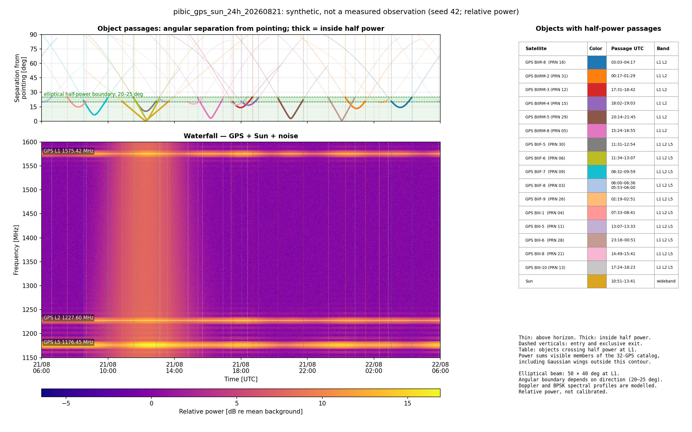
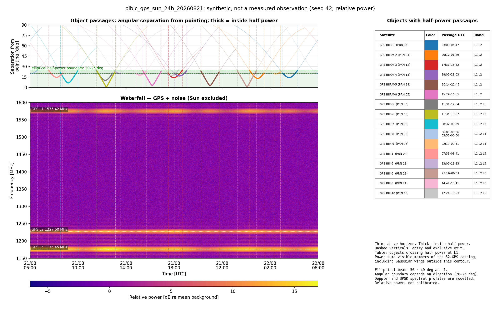
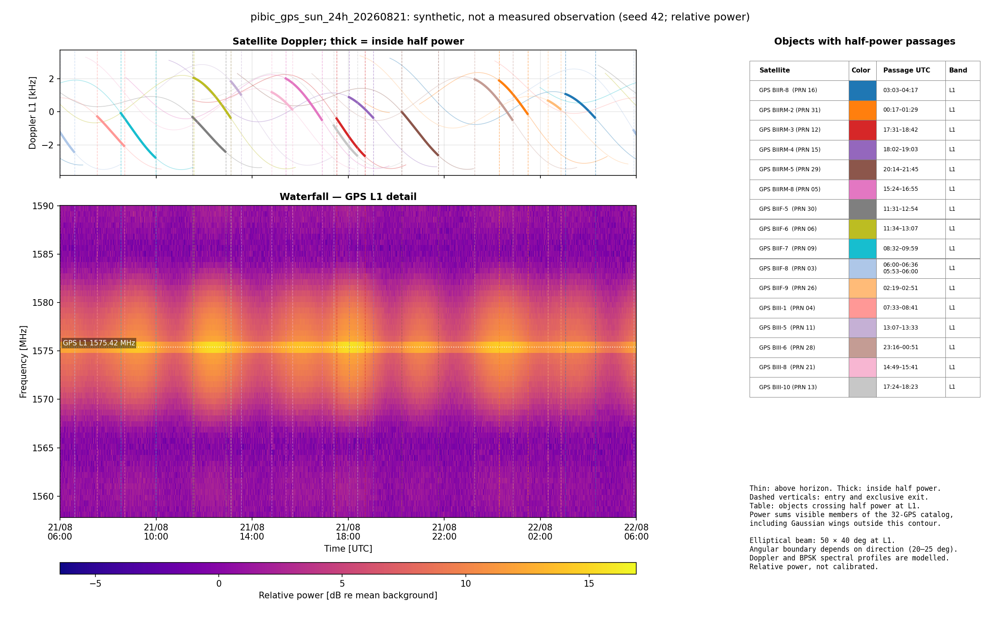
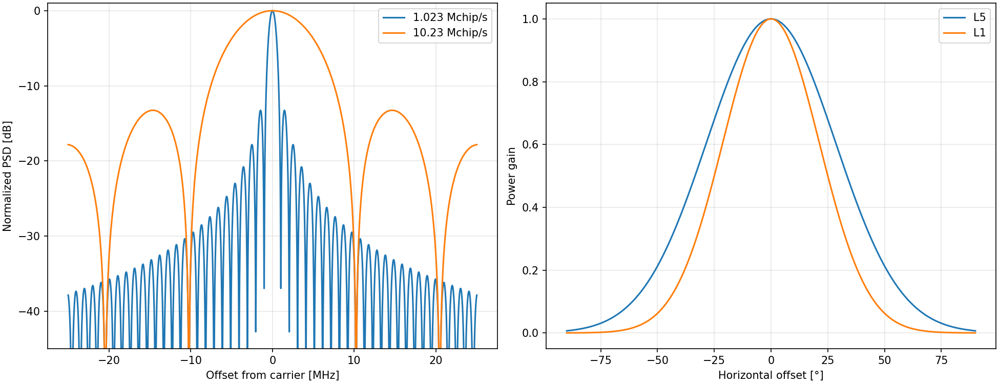
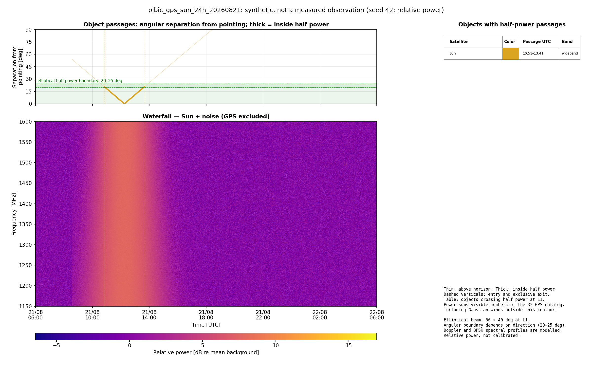

# GNSSVis 2.0 — simulação de 24 horas

[Código atualizado (ZIP)](../../downloads/GNSSVis_2_0_codigo_atualizado.zip?raw=true) · [Dados da simulação (ZIP)](../../downloads/GNSSVis_2_0_dados_24h.zip?raw=true)

32 GPS, 17 passagens de 16 satélites distintos, até três simultâneos no feixe.
Sol no eixo às 09h15 de Recife em 21/08/2026; simulação de 24 horas.
O Sol quieto tem contínuo térmico ilustrativo; as amplitudes não são medidas.

## Waterfall e geometria

## GPS sem contribuição solar

## L1 e Doppler físico

## Modelos de espectro e feixe

## Sol sem contribuição dos GPS

Consulte [fórmulas, fontes e reprodução](../REALISTIC_SIMULATION.md).

Validação: 110 testes passaram, um teste preexistente ignorado; sete controles
de consistência da simulação aprovados.

O ZIP de dados omite apenas a matriz total redundante. `reconstruir_waterfall.py`
recria o NPZ original por soma em float32, sem perda numérica.

Gráficos no padrão GNSSVis: fundo branco, plasma, trajetórias acima e tabela de objetos à direita. O painel superior mostra separação angular, trajetórias finas e trechos destacados; linhas verticais e tabela indicam entrada, saída e bandas.
